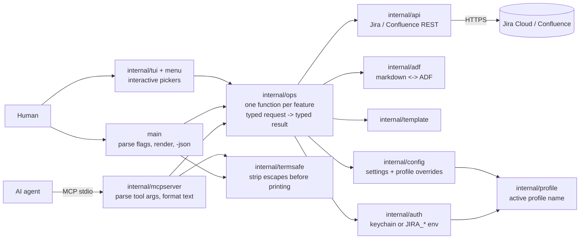
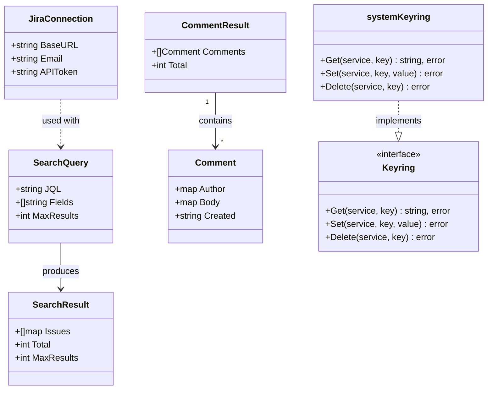
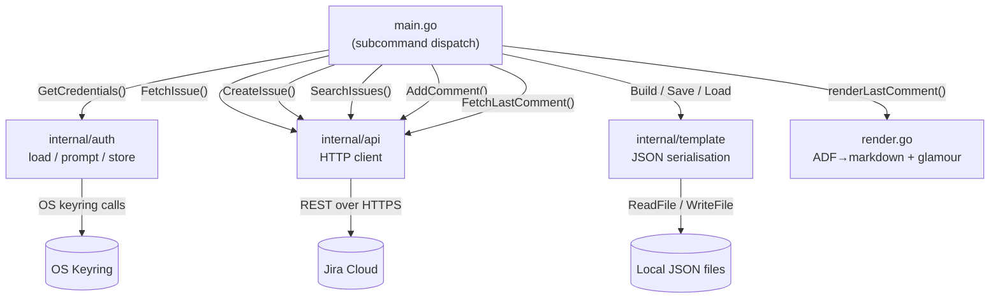

# Architecture

## Overview

`jira-thing` is a Jira and Confluence tool for agents and humans alike. It is **MCP-first**: every feature exists as an MCP tool (`serve-mcp`), and the CLI and TUI are thin front ends that call the same code. All feature logic lives once in `internal/ops`; the front ends only parse input and format results.

### Rules

- A new feature is built in this order: `internal/ops` function with tests, then the MCP tool, then the CLI command, then the TUI/menu entry where one applies.
- MCP handlers and CLI `run*` functions do not call `internal/api` to change anything; they call `internal/ops`.
- `parity_test.go` parses the CLI dispatch switches and fails if a command has no mapped MCP tool, unless it is listed as local-only (`version`, `completion`, `menu`, `state`, `open`, ...).

## Package Responsibilities

| Package | Responsibility |
|---|---|
| `main` | Subcommand routing, flag parsing, prompts, styled output; calls `internal/ops` |
| `internal/mcpserver` | MCP tool schemas and handlers; calls `internal/ops`; generates the README tool table |
| `internal/ops` | Feature logic shared by every front end: create/update/batch (with custom fields and list edits), dedupe, clone, transitions, assign, watch, sprints, catalogues, list queries and columns, describe, delete, worklog, whoami, templates, toil sync, diagnose |
| `internal/adf` | Markdown→ADF (goldmark) and ADF→markdown conversion |
| `internal/termsafe` | Strips terminal control and bidi characters from Jira-authored text; `Line` also keeps a value on one line, for terminal and MCP output |
| `internal/api` | HTTP requests to the Jira and Confluence REST APIs; validates issue keys before they enter a URL |
| `internal/auth` | Credential load/store via the OS keyring, per profile; `JIRA_URL`/`JIRA_EMAIL`/`JIRA_API_TOKEN` override it |
| `internal/profile` | The active profile name (`-profile` or `JIRA_THING_PROFILE`) and its keyring key suffix |
| `internal/template` | Build, save, and load JSON ticket templates |
| `internal/tui` | Bubble Tea pickers, tables and menus |
| `internal/config` | `~/.config/jira-thing/jira-thing.json` settings, with the active profile's `profiles` overrides applied |

## Class Diagram

## Data Flow

High-level summary — see **[`docs/dfd.md`](dfd.md)** for full Yourdon–DeMarco DFDs
(Level 0 context, Level 1 decomposition, Level 2 per-command flows).

## Commands

| Command | Description |
|---|---|
| `template <KEY> [-o file]` | Fetch a ticket, extract reusable fields, write JSON template |
| `create [-t file]` | Load a template, prompt for summary/description, create ticket |
| `update <KEY> [-stdin]` | Add a comment via `$EDITOR` or stdin |
| `last-comment <KEY>` | Fetch and render the most recent comment as markdown |
| `my-tasks [-notupdated]` | List open tickets assigned to `currentUser()`; `-notupdated` filters to tickets idle for 3+ business days |
| `state [KEY]` | TUI to move a ticket to a new workflow state; transitions are read live via `FetchTransitions` since workflows are customised per board |
| `assign <KEY> <WHO>` | Set the assignee via `ops.AssignTicket`; names and emails resolve through `ops.ResolveUser` (user search, exact match wins), and an ambiguous name opens a picker only in a terminal |
| `sprint list\|add` | Sprints via `ops.ListSprints`/`ops.FindSprint`/`ops.AddToSprint`; the board resolves from `-b`, config `board`, then the project's only sprint board (`ops.ResolveBoard`) |
| `board list`, `project list`, `release list` | Read-only catalogues via `ops.ListBoards`/`ops.ListProjects`/`ops.ListReleases`; the API layer pages through every result with the generic `fetchAllPages` |
| `worklog add`, `delete`, `clone`, `me` | `ops.LogWork` (duration checked locally), `ops.DeleteTicket` (inspects first, refuses subtasks without cascade), `ops.CloneTicket` (`-replace` rewrites summary and ADF text nodes on a copy), `ops.WhoAmI`; all but `me` take `-dry-run` |
| `watch`/`unwatch <KEY> [WHO]`, `watchers <KEY>` | `ops.WatchTicket` resolves WHO through `ops.ResolveUser` (default: you) and calls `api.AddWatcher`/`RemoveWatcher`; ambiguous names reuse assign's picker via the generic `retryWithPick` |
| `list [filters] [-plain\|-csv\|-json] [-columns]` | `ops.ListTickets` builds JQL with `ops.BuildListJQL` (shared with the MCP `search_tickets` filters) and pages via `api.SearchAll`; `ops.TicketRow` extracts column values for both front ends, and `listfmt.go` renders tables, CSV and JSON |
| `create -no-template` | Starts from an empty base instead of `template.LoadFromDir`. Without it, a template found on the search path is announced on stderr (`LoadFromDir` returns the file it read), because its labels and components otherwise land on "flags only" creates unseen (GitHub #38) |
| `template list`, `create -T NAME` | `ops.ListTemplates`/`ops.LoadTemplate` combine `template.ListNamed`/`LoadNamed` (files in `template.NamedDir`) with the config-derived built-ins `standard` and `toil`; a file wins over a built-in. `template.NamedPath` keeps names to `[A-Za-z0-9_-]+` because MCP agents pass them (`list_templates`, `create_ticket`'s `template`) |
| `create` config defaults | `ops.DefaultsFromConfig` turns `default_priority`, `default_components` and `default_labels` into `CreateRequest.Defaults` (or `BatchOptions.Defaults`); `createFields` applies them after the typed fields, only to fields still unset. `template.LoadFromDir` searches `templates_dir` before the usual path |
| `create -sprint S -points N` | `ops.CreateTicket` validates the points and resolves the sprint (`ops.CreateSprintScope` picks the board) before the POST, then adds the ticket to the sprint and sets the points through `ops.UpdateTicket`'s edit-screen lookup; failures after the POST land on `CreateResult` and `ops.FollowUpError` reports them, as for the parent link |
| `create`/`edit -custom Name=value` | `ops.ResolveCustomFields` reads the field registry once, matches names or IDs (`ops.AmbiguousFieldError` on duplicates) and converts values by `schema.type`; create adds them after `PreparePayload`, which strips every `customfield_*` key from templates |
| `edit -label [-]L -component [-]C -fix-version [-]V` | `ops.ListEdits` become Jira's `update` verbs (`{"labels": [{"add": …}, {"remove": …}]}`) beside `fields` in one PUT built by `api.EditBody`; a field both replaced and edited is refused, as Jira rejects it |
| `edit -type T -points N` | `ops.UpdateTicket` reads the ticket's edit screen (`api.FetchEditMeta`) only when type or points change: the type must be in `issuetype.allowedValues`, and points go to the first of `ops.StoryPointFields(cfg)` on the screen. `point-check` reads the same list |
| `epic explore`, `sprint explore` | `tui.ShowExplorer`: a sidebar of `ExplorerGroup`s and an issue table, loading each group in the background through a `GroupLoader` (`ops.ListEpicIssues`, `ops.ListSprintIssues`) and caching it. A quick action ends the program; `runExplorer` performs it with the table's `performQuickAction`, then reopens on the same group |
| `-profile NAME <command>` | `applyGlobalFlags` (globalflags.go) removes the option and calls `profile.Select`, which sets `JIRA_THING_PROFILE` so `serve-mcp` and other child processes inherit it; `auth` reads `key@NAME` keychain entries and `config.Load` overlays `profiles[NAME]` |
| `describe <KEY> -comments N` | Defaults to `ops.DefaultDescribeComments` (1) in the CLI, `describe_ticket` and the table/explorer view; `-raw` keeps 0 unless `-comments` is given, so its JSON stays the bare issue. `ops.DescribeTicket` adds the newest N comments in one request (`orderBy=-created`, reversed to read oldest first); `ops.CommentsMarkdown` renders them for both the CLI and `describe_ticket` |
| `completion bash\|zsh` | Commands, aliases and sub-commands; `completion_test.go` parses every dispatch switch so a new command or alias without completion fails the build |
| `describe <KEY>` | Render a ticket's fields, linked tickets (`api.ParseIssueLinks`) and description as markdown |
| `link-types [-json]` | List the instance's issue link types, read live via `FetchIssueLinkTypes` |
| `link <OUTWARD> <INWARD> -type T` | Create an issue link; `-type` is matched against the live link types (`mcpserver.FindLinkType`) and a missing/unknown type exits with that list |
| `unlink <KEY> <OTHER>` | Remove the link between two tickets, whichever type connects them |
| `remote-link <KEY> -url U [-title T]` | Attach a remote web link to a ticket |
| `clear-auth` | Delete all stored credentials from the OS keyring |

## Key Design Decisions

- **No database** — templates are standalone JSON files on disk.
- **`Keyring` interface** — allows unit tests to inject an in-memory mock without touching the OS keyring.
- **`executeRequest` helper** — eliminates duplicated HTTP status-check + JSON-decode logic across all API functions.
- **`SearchQuery` struct** — groups the four search parameters to keep `SearchIssues` within the single-responsibility / argument-count guidelines.
- **MCP-first, one `ops` layer** — before v0.27 the MCP handlers and the CLI each had their own copies of field building, assignee resolution, clone inheritance, transitions, dedupe and toil queries, and they had drifted (the CLI's toil JQL didn't escape quotes). Each now exists once in `internal/ops`, and `ops` results are plain structs, so `-json` output and MCP text describe the same thing.
- **Profiles stay out of the way** — the default profile uses the original keychain keys and config, so existing installs see no change. Credentials resolve in a fixed order: all three `JIRA_URL`/`JIRA_EMAIL`/`JIRA_API_TOKEN` variables, else the active profile's keychain keys, else a prompt. A partial set of variables is an error rather than being mixed with stored values.
- **Edit screen, not guesses** — issue types and story point fields vary per project and instance. `edit` checks both against the ticket's edit metadata rather than a hard-coded list, so a wrong type or missing field fails before anything is sent, with the allowed values in the error. Types outside `allowedValues` need Jira's Move flow, which `edit` doesn't attempt.
- **Deletes look before they leap** — `ops.DeleteTicket` fetches the ticket first, so every front end can show the summary and subtasks, and a ticket with subtasks is refused unless cascade is set rather than leaving Jira to fail half-way. The CLI needs a terminal to confirm in, or `-y`; the MCP tool tells agents to dry-run and confirm with the user.
- **Filters quote everything** — `ops.BuildListJQL` quotes every value with JQL escaping (`currentUser()` and the `startOf…()` keywords are the only bare tokens) and accepts `--order-by` only as a field name, so a filter value can't change the query's shape. Raw `-jql` is the deliberate escape hatch. CSV cells that a spreadsheet would treat as formulas are prefixed with `'`.
- **One paginator** — Jira's list endpoints share the `{values, isLast}` page shape, so `api.fetchAllPages[T]` serves boards, sprints, projects and versions. It stops at `isLast`, on a short page when `isLast` is missing, or after 40 pages. Project keys are checked by `api.ValidateProjectKey` before going into a URL path, just as issue keys are.
- **Sprint selectors** — `current`, `prev` and `next` are resolved in `ops.FindSprint` by asking Jira for one sprint state (active, closed, future) and picking the latest started, latest completed or first listed. A numeric ID skips the lookup entirely, so scripts that know the ID make no board calls. Board auto-detection skips only kanban boards, because team-managed boards report type `simple` yet have sprints, and it refuses to guess between several.
- **Assignee by name** — every assignee argument (`assign`, and `-assignee` on create, edit and transition) goes through `ops.ResolveUser`. Strings shaped like Cloud account IDs (24 hex characters, or `prefix:id`) skip the lookup; anything else is searched, keeping active human users only. Several matches return `ops.AmbiguousUserError` with the candidates rather than guessing, because assigning the wrong person notifies them.
- **Untrusted text** — ticket text is written by other Jira users. `internal/termsafe` strips C0/C1 controls and Unicode `Bidi_Control` characters wherever Jira text reaches the terminal, and `api.ValidateIssueKey` keeps crafted keys (`../../myself`) out of request paths. `fetch_template` never writes files, so an agent can't change the default template later CLI creates use.
- **ADF→markdown conversion** (`internal/adf`) — Jira Cloud API v3 returns comment bodies as Atlassian Document Format (ADF), not raw markdown. `adf.ToMarkdown` recursively walks the ADF node tree to produce standard markdown, which is then rendered to styled terminal output via [glamour](https://github.com/charmbracelet/glamour).
- **Markdown→ADF conversion** (`internal/adf`) — comment and description text is parsed as markdown with [goldmark](https://github.com/yuin/goldmark) (Table and Strikethrough extensions enabled) and converted to structured ADF nodes (`heading`, `bulletList`, `orderedList`, `codeBlock`, `blockquote`, `table`, `rule`, marks for strong/em/code/strike/link) before posting. Previously the whole text was sent as a single plain-text node, so markdown appeared raw in the Jira web UI. `adf.FromMarkdown` is the inverse of `adf.ToMarkdown`.
- **Duplicate guard** (`ops.DedupeGuard`, `api.FindOpenIssueBySummary`) — JQL's `~` is a fuzzy text match, so it only narrows the candidates and an exact summary comparison decides. The guard fails closed: if the check can't complete, nothing is created. A batch also remembers what the run created, because a fresh ticket isn't in Jira's search index for about 3 seconds (measured once on Jira Cloud). Across separate runs that gap is unguarded: an immediate retry still creates a duplicate.
- **Two-call last-comment fetch** — `FetchLastComment` first requests one comment to read `total`, then requests `startAt=total-1` to fetch the last without downloading all comments.
